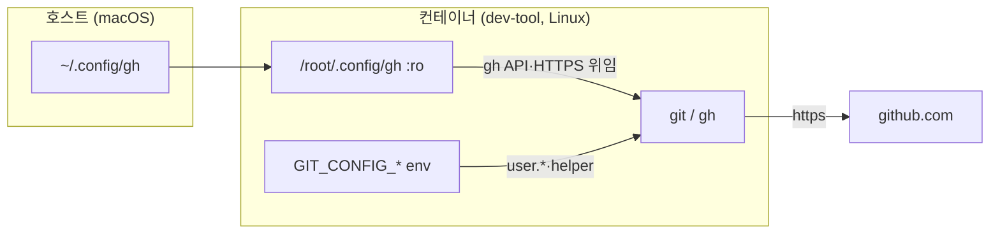

# GitHub 자격증명 호스트·컨테이너 공유

`dev-tool` 컨테이너 기준입니다.

## 현재 배선

- 공유: `~/.config/gh` → `/root/.config/gh:ro` (토큰)
- 주입: compose env 4항목 (작성자 + 헬퍼)
- 미마운트: `~/.gitconfig`, `~/.ssh` (`/root/.gitconfig`·`/root/.ssh` 없음)
- 이미지: `node:22-bookworm-slim` + `git openssh-client ca-certificates gh zsh` + `pnpm@11` + `opencode-ai`



## 변수별 설정

행번호는 `dev-tool/Dockerfile.dev`(ENV), `dev-tool/docker-compose.yml`(volumes) 기준입니다.

| 변수 (행) | 값 | 적용 결과 |
|---|---|---|
| `GIT_CONFIG_COUNT` (Dockerfile 26) | `"4"` | 아래 4항목을 git `-c`로 적용합니다. |
| `GIT_CONFIG_KEY_0` / `VALUE_0` (Dockerfile 27–28) | `user.name` = `devjhc` | 커밋 작성자 이름입니다. |
| `GIT_CONFIG_KEY_1` / `VALUE_1` (Dockerfile 29–30) | `user.email` = `devjhc@outlook.com` | 커밋 작성자 이메일입니다. GitHub 계정 귀속 기준입니다. |
| `GIT_CONFIG_KEY_2` / `VALUE_2` (Dockerfile 31–32) | `credential.https://github.com.helper` = (빈값) | helper 목록을 리셋합니다. |
| `GIT_CONFIG_KEY_3` / `VALUE_3` (Dockerfile 33–34) | 같은 키 = `!gh auth git-credential` | HTTPS 자격증명을 gh 토큰에 위임합니다. |
| `volumes` (compose) | `~/.config/gh:/root/.config/gh:ro` | 토큰 공급입니다. |
| `volumes` (compose) | opencode config `:ro` + `skills` `:rw` + `auth.json` `:ro` | skill 작성은 가능, 설정·db 공유 없음. |
| 삭제된 행 | `~/.gitconfig`·`~/.ssh` 마운트, `insteadOf` env | SSH 원격 사용 불가. |

`GIT_CONFIG_*`는 `git -c`와 같은 최우선 순위라 파일 설정을 덮습니다.

git config 적용 순서(뒤가 앞을 덮습니다):

```text
/etc/gitconfig        system   — VS Code 원격 헬퍼
~/.gitconfig          global   — dev-tool은 미마운트
<repo>/.git/config    local    — 리포별 설정
GIT_CONFIG_* / -c     최우선    — compose env
```

## 실행 경로 차이

| 쪽 | helper 값 | 해석 |
|---|---|---|
| 호스트 `~/.gitconfig` | `!/opt/homebrew/bin/gh auth git-credential` | macOS 절대경로. 컨테이너에 없음 |
| 컨테이너 env (`GIT_CONFIG_VALUE_3`) | `!gh auth git-credential` | PATH 탐색 → `/usr/bin/gh` 실행 |

## 기능과 담당 도구

`gh`(GitHub CLI)는 GitHub 공식 커맨드라인 도구입니다. PR·이슈·릴리스·Actions를 터미널에서 다루고 GitHub API를 직접 호출합니다. 인증 토큰을 `~/.config/gh/hosts.yml`에 저장하고, 그 토큰을 git의 HTTPS credential helper로 위임하는 `gh auth git-credential`을 제공합니다. SSH는 git 전송 프로토콜 전용이라 GitHub API는 다루지 못합니다.

| 기능 | ssh | gh |
|---|---|---|
| 로컬 커밋 생성 | 무관 | 무관 |
| 커밋 계정 귀속 | 무관 | 무관 |
| clone/fetch/pull/push (SSH 원격) | O | X |
| clone/fetch/pull/push (HTTPS 원격) | X | O |
| PR 생성·조회·리뷰·머지 | X | O |
| 이슈 생성·조회·코멘트 | X | O |
| 릴리스·태그·Actions 조회·실행 | X | O |
| 인증 상태 점검 | O (`ssh -T git@github.com`) | O (`gh auth status`) |

- 커밋과 push의 인증은 별개입니다. 커밋은 `user.email`로 계정 귀속이 결정되고, push는 `~/.ssh` 또는 gh 토큰으로 인증됩니다.
- helper는 목록입니다. 빈값 항목이 파일 기여분을 리셋하고, 다음 항목이 gh를 등록합니다. 순서가 바뀌면 리셋이 gh까지 지웁니다. 리셋이 없으면 파일의 깨진 항목이 먼저 실행되어 `not found` 오류가 출력됩니다(실측).
