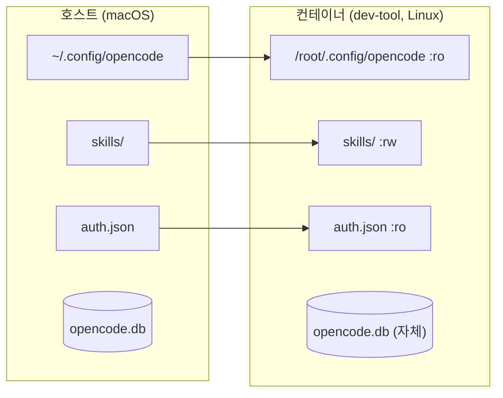

# opencode 설정 호스트·컨테이너 공유

`dev-tool` 컨테이너 기준입니다.

## 현재 배선

- 공유(`:ro`): `~/.config/opencode` (설정·스킬 읽기), `~/.local/share/opencode/auth.json` (로그인)
- 쓰기(`:rw`): `~/.config/opencode/skills`만 오버레이
- 미공유: `opencode.db` (세션 DB는 컨테이너 자체 저장)
- 버전: 호스트 `opencode v2.0.32`, 컨테이너 `opencode-ai@1.19.3` (채널이 다름)

## 변수별 설정

행번호는 `dev-tool/docker-compose.yml` 기준입니다.

| 바인딩 (행) | 내용 |
|---|---|
| `.:/workspace/dev-tool` (10) | 작업공간 공유입니다. |
| `~/.config/opencode:/root/.config/opencode:ro` (14) | `opencode.json`, `docs/AGENTS.md`, `skills/` 읽기. `cli.json`·`service.json` 쓰기 불가. |
| `~/.config/opencode/skills:...:rw` (15) | 컨테이너에서 skill 작성 시 호스트에 반영됩니다. |
| `~/.local/share/opencode/auth.json:...:ro` (17) | 로그인 공유. 토큰 갱신은 호스트에서만 합니다. |

`~/.config/opencode`에는 `node_modules/` 등 62M 중 컨테이너와 무관한 파일이 포함되어 있습니다. 실제 사용분은 `opencode.json`, `docs/`, `skills/`입니다.

## 버전 차이

| 쪽 | 버전 | 출처 |
|---|---|---|
| 호스트 | `opencode v2.0.32` | v2 채널 |
| 컨테이너 | `opencode-ai@1.19.3` | npm `opencode-ai@latest` (레지스트리 latest와 일치, 실측) |

npm 패키지 기준 latest가 1.19.3이므로 빌드 시점 최신이 맞습니다. 호스트 v2와 채널이 달라 설정 해석·기능이 다를 수 있습니다.

## 공유 범위

| 경로 | 공유 여부 | 내용 |
|---|---|---|
| `~/.config/opencode/opencode.json` | 공유 (`:ro`) | `instructions: ["~/.config/opencode/docs/AGENTS.md"]` |
| `~/.config/opencode/skills/` | 공유 (`:rw`) | 컨테이너 작성분은 호스트에 기록됩니다. |
| `~/.local/share/opencode/auth.json` | 공유 (`:ro`) | 600 권한, 로그인 1회 목적에 부합합니다. |
| `~/.local/share/opencode/opencode.db` | 미공유 | 컨테이너는 자체 db 사용 중입니다(실측 6.8M+WAL). SQLite를 바인드 마운트越し로 공유하면 잠금 불안정이 있습니다. |

## fleet 대비

- `che/cmb/node-test`: config `:ro` + `auth.json` `:ro` (dev-tool과 동일 패턴)
- `mcp-server` 2종: config `:ro` + share 디렉터리 전체 공유 (db 공유 중)
