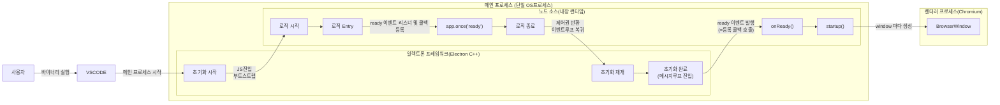
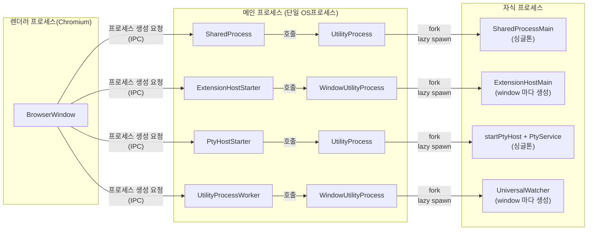
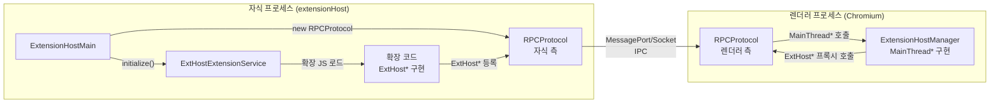

# VS Code 시작 흐름

## 전체 ASCII 트리

```text
OS (바이너리 실행)
└─ Electron 메인 프로세스 생성 (C++)   ★ 최초·유일 main, 아래 ★는 자식 OS프로세스 생성
   ├─ [mainImpl.ts] 인자·userData·메뉴·크래시·스킴 설정 + app.once('ready') 등록
   │   └─ ready 방출 = main 초기화 완료 (BrowserWindow 아님)
   └─ [JS] onReady() → startup()
      └─ bootstrapESM → import electron-main/main.js
         └─ CodeMain.main() → startup()
            ├─ createServices / initServices (경로 mkdir·state·config)
            ├─ claimInstance (mainIPCHandle 선점, 실패 시 기존 인스턴스에 위임 후 종료)
            └─ CodeApplication.startup()
               ├─ setupSharedProcess (객체 등록만, spawn 아님)
               ├─ initServices (Windows·Dialog·Launch·Storage·Terminal·Telemetry 등 ~20종)
               ├─ initChannels·프로토콜 핸들러
               └─ openFirstWindow      ★ 렌더러 생성 (window 마다 BrowserWindow 1개 = 별도 OS프로세스)
                  ├─ workbench 로드 (렌더러 내부, 요청자)
                  ├─ 요청:렌더러→실행:main Shared: SharedProcess + UtilityProcess → SharedProcessMain (싱글톤, 지연)
                  ├─ 요청:렌더러→실행:main extensionHost: ExtensionHostStarter + WindowUtilityProcess → ExtensionHostMain (window 마다 생성, 지연)
                  ├─ 요청:렌더러→실행:main ptyHost: PtyHostStarter + UtilityProcess → startPtyHost + PtyService (싱글톤, 지연)
                  └─ 요청:렌더러→실행:main fileWatcher: UtilityProcessWorker + WindowUtilityProcess → UniversalWatcher (window 마다 생성, utilityWorker 경유)
```

## 렌더러 프로세스 생성까지



## 렌더러 생성 이후

* 싱글톤인 자식 프로세스는 한번 생성 후는 연결만 가져온다.



## 확장호스트 내부

* 확장호스트 프로세스는 자체 기능 없음. 껍데기(`ExtensionHostMain` + `RPC`) + 로드된 확장 코드(`ExtHost*`) + 렌더러의 `MainThread*` 조합으로 동작한다.


